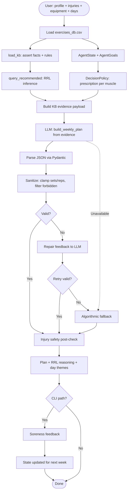
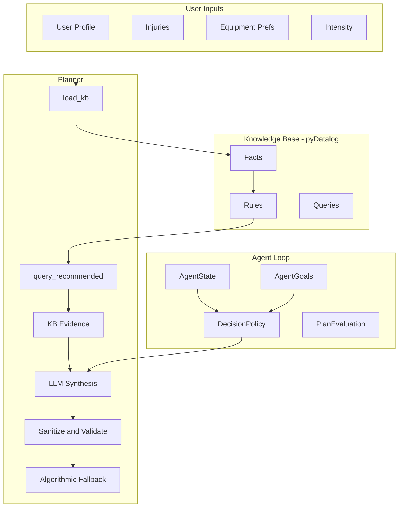
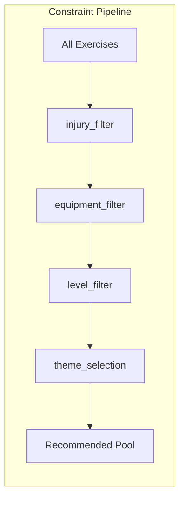
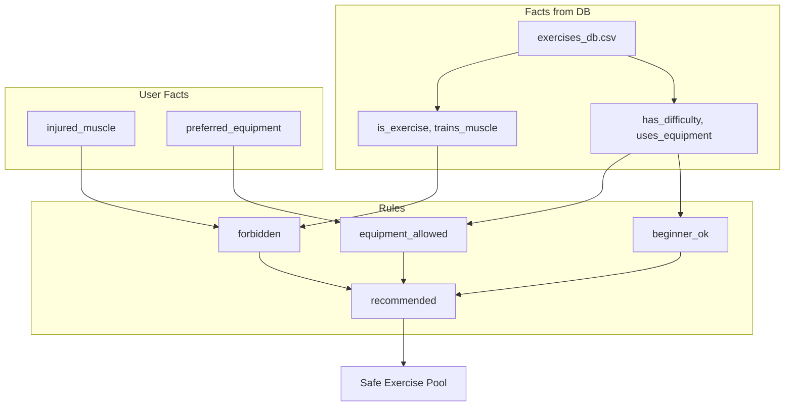
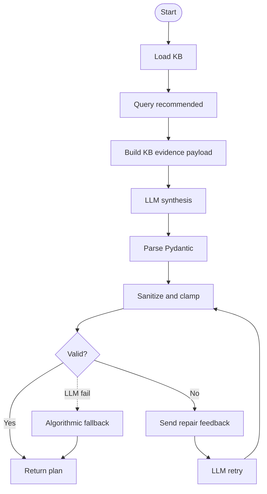
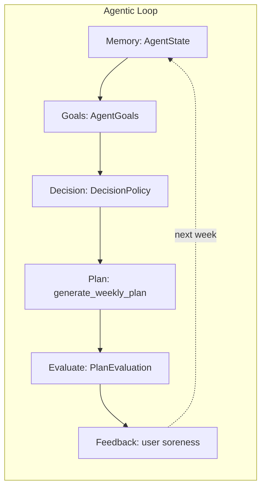
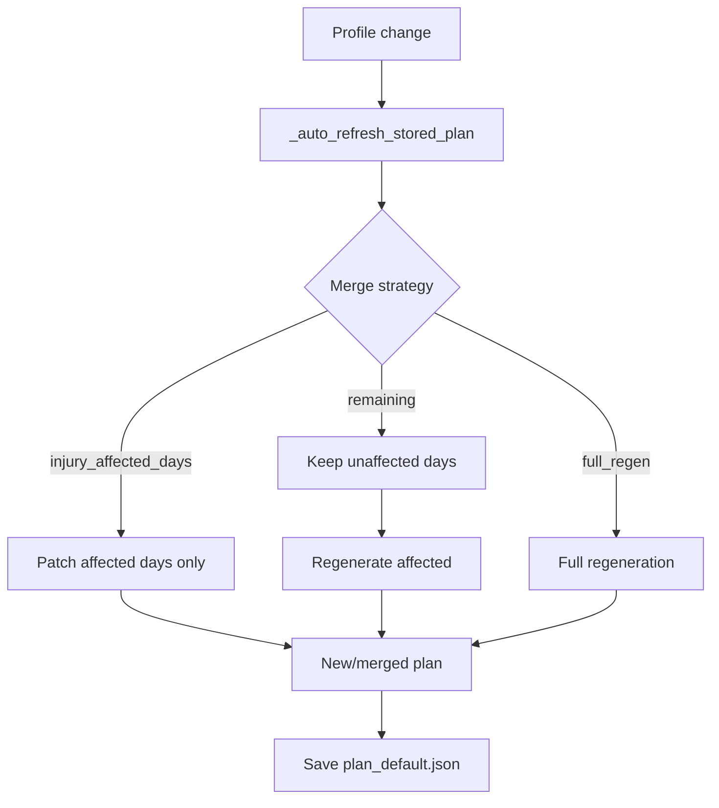
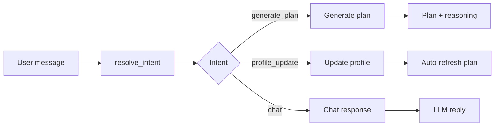

# Agentic Workout Planner: Representation, Reasoning, and Language for Personalized Exercise Planning

## 1. Abstract and Introduction

Fitness applications often rely on static templates or opaque AI models that ignore user-specific constraints (injuries, equipment, fitness level). This project presents an **Agentic Workout Planner** that generates safe, personalized **2–7 day weekly plans** using:

- **Representation, Reasoning, and Language (RRL)** — pyDatalog for declarative, interpretable constraint handling
- **LLM** — Azure OpenAI for plan synthesis and natural-language explanations
- **Deterministic safety** — validation, sanitization, and algorithmic fallbacks

The system exposes the facts, rules, and inference steps used to recommend or forbid exercises, with optional plain-English explanations via the LLM.

## 2. End-to-End Flow



## 3. Objectives and Research Goals

The project aims to achieve the following:

| Goal | Description |
| ---- | ----------- |
| **Injury safety** | Exclude exercises that target injured muscles; support joint-to-muscle mapping (e.g., "knee" → quads, hamstrings, calves) |
| **Personalization** | Days per week (2–7), intensity (1–5), equipment preferences, experience level (beginner focus) |
| **Dynamic plan synthesis** | No hardcoded splits; plans derived from KB evidence and LLM synthesis |
| **Interpretability** | Expose RRL facts, rules, and inference per day; optional LLM plain-English explanations |
| **Agentic loop (CLI)** | Memory (soreness, volume) → Goals → Decision → Plan → Evaluate → Feedback |
| **Dynamic plan updates (API/web)** | Profile changes (injuries, equipment, intensity) trigger plan refresh with merge strategies |

## 4. System Architecture



### Modules

| Module | File | Responsibility |
| ------ | ---- | -------------- |
| **RRL** | `agent/krr.py` | pyDatalog KB, facts, rules, queries, reasoning summaries |
| **Agent State** | `agent/agent_state.py` | AgentState, AgentGoals, JSON persistence |
| **Decision Policy** | `agent/decision_policy.py` | DecisionPolicy, PlanEvaluation |
| **Meta-Control** | `agent/mcp.py` | Orchestrates state → plan → evaluation cycle |
| **LLM** | `agent/llm.py` | Azure OpenAI: chat, intent, explanations, plan synthesis |
| **Weekly Planner** | `planner/weekly_planner.py` | KB evidence + LLM synthesis + validation + fallback |
| **Constraints** | `planner/constraints.py` | Planning bounds (days, sets, reps, exercises/day) |
| **Validation** | `planner/validation.py` | Deterministic plan verification |
| **LLM Contract** | `planner/llm_contract.py` | Pydantic schema for LLM output |
| **API** | `api/app.py` | REST API: health, profile, intent, plan, chat, explanations |

## 5. Representation, Reasoning, and Language (RRL)

### 5.1 Ontology

pyDatalog predicates and rules:

#### 5.1.1 Predicates

- `is_exercise(E)` — E is an exercise in the database
- `trains_muscle(E, M)` — exercise E targets muscle M
- `has_difficulty(E, D)` — exercise E has difficulty level D
- `uses_equipment(E, Eq)` — exercise E uses equipment Eq
- `injured_muscle(User, M)` — user has an injured muscle M
- `preferred_equipment(User, Eq)` — user prefers equipment Eq

#### 5.1.2 Rules

```datalog
forbidden(User, Exercise) <- trains_muscle(Exercise, M) & injured_muscle(User, M)
```

An exercise is forbidden if it trains any muscle the user has injured.

```datalog
equipment_allowed(User, Exercise) <- preferred_equipment(User, Eq) & uses_equipment(Exercise, Eq)
equipment_allowed(User, Exercise) <- uses_equipment(Exercise, "body weight")
```

Equipment is allowed if the user prefers it, or if the exercise uses body weight (always allowed).

```datalog
beginner_ok(E) <- is_exercise(E) & has_difficulty(E, "beginner")
```

```datalog
recommended(User, Exercise) <- beginner_ok(Exercise)
  & NOT forbidden(User, Exercise)
  & (no preferred equipment OR equipment_allowed(User, Exercise))
```

Recommended exercises are beginner-level, not forbidden, and equipment-compatible when preferences are set.

### 5.2 Ontology Mappings

#### 5.2.1 Muscle Aliases

| Common Name | Canonical (DB) |
| ----------- | -------------- |
| chest | pectorals |
| shoulders, shoulder | delts |
| back | lats |
| legs | quads |
| arms, arm | biceps |

#### 5.2.2 Muscle Group Expansions

- **back** → lats, upper back, traps, levator scapulae
- **legs** → quads, hamstrings, glutes, calves, adductors, abductors
- **arms** → biceps, triceps, forearms

#### 5.2.3 Joint → Muscle Map

| Joint | Muscles |
| ----- | ------- |
| shoulder | delts, traps, upper back, levator scapulae |
| elbow | biceps, triceps, forearms |
| wrist | forearms |
| hip | glutes, hamstrings, adductors, abductors |
| knee | quads, hamstrings, calves |
| ankle | calves |
| spine | upper back, lats, abs |

#### 5.2.4 Equipment Aliases

| Input | Canonical |
| ----- | --------- |
| bodyweight, body-weight | body weight |
| dumbbells | dumbbell |
| barbells | barbell |
| kettlebells | kettlebell |
| bands | band |
| resistance bands | resistance band |
| cables | cable |
| machines | leverage machine |

### 5.3 Constraint Pipeline

The filtering order is:

1. **injury_filter** — exclude forbidden exercises
2. **equipment_filter** — restrict to preferred or body-weight equipment
3. **level_filter** — beginner exercises only
4. **theme_selection** — muscle focus per day



### 5.4 Inference Flow



### 5.5 Data Source

- **File**: `data/exercises_db.csv`
- **Columns**: Serial Number, bodyPart, equipment, id, name, target, secondaryMuscles, instructions, description, difficulty, category

## 6. Hybrid Planning: RRL + LLM

### 6.1 Planning Flow

1. **Load KB** — Assert exercise facts and user injury/equipment facts into pyDatalog
2. **Query recommended** — Get beginner, non-forbidden, equipment-compatible exercises
3. **Build evidence payload** — Compact `recommended_by_muscle`, rules, injuries, equipment for the LLM
4. **LLM synthesis** — LLM produces a full plan (days, themes, muscles, exercises) from evidence
5. **Parse** — Pydantic schema validates structure
6. **Sanitize** — Clamp sets/reps, filter unknown/forbidden exercises, fill under-selected days from KB
7. **Validate** — Check allowed exercises, set/rep ranges, weekly volume per muscle
8. **Repair (if invalid)** — Send verification issues as repair feedback to LLM; retry once
9. **Fallback** — If still invalid or LLM unavailable, use algorithmic plan generation



### 6.2 Constraints

| Parameter | Min | Max | Default |
| --------- | --- | --- | ------- |
| Days per week | 2 | 7 | 5 |
| Sets per exercise | 2 | 4 | — |
| Reps per set | 6 | 20 | 12 |
| Exercises per day | — | 6 | — |
| Sets per muscle per week | — | 20 | 20 |

### 6.3 LLM Capabilities

| Method | Purpose |
| ------ | ------- |
| `build_weekly_plan()` | KB-grounded plan synthesis (JSON output) |
| `explain_plan()` | Per-day natural-language explanation |
| `explain_krr_reasoning()` | Translate symbolic RRL to plain English (4–5 bullets, grounded) |
| `resolve_intent()` | Classify intent (generate_plan, profile_update, chat); extract days, injuries, equipment |
| `chat()` | Free-form Q&A with plan, profile, and RRL context |
| `activity_hint()` | Short status text for UI |

The LLM uses **only** exercises from the provided KB evidence; body-weight is always allowed.

## 7. Agentic Loop and State

### 7.1 AgentState

- **soreness_per_muscle** — Post-workout soreness level per muscle (1–5)
- **weekly_volume_per_muscle** — Total sets per muscle in the current plan
- **missed_sessions** — List of day labels that were skipped

**Methods**: `record_week_volume()`, `update_from_feedback()`, `record_missed_session()`, `save()`, `load()`

**Persistence**: `data/agent_state_{user_id}.json`

### 7.2 AgentGoals

- `target_soreness_min` = 1.0
- `target_soreness_max` = 3.0
- `max_sets_per_muscle_per_week` = 20

### 7.3 DecisionPolicy

Produces a **prescription** per muscle: `target_sets`, `scale`, `priority` (high/normal/low).

- High soreness or volume near max → reduce sets (scale 0.6), priority low
- Low soreness and under cap → allow more (scale 1.2), priority high
- Otherwise → normal

### 7.4 PlanEvaluation

- Counts sets per muscle across the plan
- Flags muscles exceeding `max_sets_per_muscle_per_week`
- Returns `(is_valid, suggestions)` with modification suggestions

### 7.5 Meta-Control (MCP)

`run_plan_cycle()`:

1. Load or create AgentState and AgentGoals
2. Call `generate_weekly_plan()` with state and goals
3. Evaluate plan with PlanEvaluation
4. If invalid: reduce sets and re-evaluate
5. Apply injury safety post-check (remove any remaining forbidden exercises)
6. Return plan, evaluation status, suggestions, RRL reasoning, day themes



## 8. Dynamic Plan Updates (API/Web)

Profile changes (injuries, equipment, intensity, days) trigger `_auto_refresh_stored_plan_for_profile()`:

- **Merge strategies**:
  - `injury_affected_days` — Patch only days affected by injury changes
  - `remaining` — Keep unaffected days; regenerate affected ones
  - `full_regen` — Full regeneration with new profile

**Intent routing** (`resolve_intent()`): `generate_plan`, `profile_update`, or `chat`. Injury semantics: injured/add, recovered/remove, cleared/clear.





## 9. API and Frontend

### 9.1 REST API Endpoints

| Endpoint | Method | Purpose |
| -------- | ------ | ------- |
| `/api/health` | GET | Health check |
| `/api/profile` | GET, PUT | Load, save user profile |
| `/api/intent` | POST | Resolve intent from message |
| `/api/plan` | POST | Generate plan |
| `/api/plan/day/regenerate` | POST | Regenerate one day |
| `/api/plan/day/reduce` | POST | Reduce exercises for a day |
| `/api/plan/day/swap` | POST | Swap exercises |
| `/api/chat` | POST | Free-form chat |
| `/api/explanation` | POST | Per-day explanation |
| `/api/global-reasoning` | POST | Global RRL reasoning |
| `/api/counterfactual` | POST | Injury what-if analysis |
| `/api/krr_trace` | GET | RRL reasoning trace |
| `/api/reasoning` | GET | Reasoning summary |
| `/api/injury-map` | GET | Joint/muscle mapping |
| `/api/equipment-options` | GET | Equipment list |
| `/api/db` | GET | Exercise database |

### 9.2 React Frontend

- **Profile card** — Days/week, injuries (joint/muscle), intensity, equipment preferences
- **Plan cards** — One per day; expandable exercises with sets/reps
- **See Thinking** — Toggle for RRL reasoning and LLM explanation per day
- **Chat panel** — Intent-aware responses; supports "generate plan", "update injuries", etc.
- **Dynamic update context** — When profile changes, shows added/removed exercises per day

```mermaid
flowchart TB
    subgraph client [React Frontend]
        Profile[Profile Card]
        Plan[Plan Cards]
        Chat[Chat Panel]
        Thinking[See Thinking toggle]
    end

    subgraph api [FastAPI Backend]
        ProfileAPI[/api/profile]
        PlanAPI[/api/plan]
        ChatAPI[/api/chat]
        IntentAPI[/api/intent]
        ExplainAPI[/api/explanation]
    end

    Profile <--> ProfileAPI
    Plan <--> PlanAPI
    Chat --> IntentAPI
    Chat --> ChatAPI
    Thinking --> ExplainAPI
```

## 10. Testing and Validation

| Test File | Coverage |
| --------- | -------- |
| `tests/test_agentic_reliability.py` | RRL filtering, joint mapping, equipment, policy, fallback, injury post-filter |
| `tests/test_reliability.py` | Constraints, `verify_day_specs`, unknown exercise rejection |
| `tests/test_intent_routing.py` | Heuristic intent, profile updates, days extraction |
| `tests/test_dynamic_plan_updates.py` | Profile changes, merge strategies |

Run: `python -m unittest discover -s tests`

## 11. Deployment and Tech Stack

### Python Dependencies

- pandas >= 1.3.0
- pyDatalog >= 0.17.0
- openai >= 1.0.0
- fastapi >= 0.104.0
- uvicorn[standard] >= 0.24.0
- pydantic
- python-dotenv >= 1.0.0

### Frontend

- React 18.2, Vite 5, react-markdown, remark-gfm

### Deployment

- **Docker**: Multi-stage build; serves React frontend + FastAPI from one container
- **Hugging Face Spaces**: Docker SDK, port 7860

### Run Options

- **CLI**: `python main.py` — Plan + RRL reasoning + LLM explanations + soreness feedback
- **API**: `python api.py` — FastAPI on 127.0.0.1:8000 (or `uvicorn api.app:app --reload --port 8000`)
- **Web**: `cd web && npm run dev` — React dev server on `http://localhost:5173`

## 12. Conclusions and Future Directions

### Summary

The planner uses a **hybrid RRL + LLM** architecture: the KB provides declarative rules for injury safety and equipment compatibility; the LLM synthesizes plans from KB evidence; validation and fallbacks ensure safety when LLM output is invalid.

### Key Properties

- **Injury safety** — Exercises targeting injured muscles excluded via RRL
- **Interpretability** — Symbolic reasoning is exposed per day; LLM can translate to plain English
- **Groundedness** — LLM is instructed to use only KB-recommended exercises
- **Fallback** — Algorithmic plan generation when LLM is unavailable or output invalid

### Future Directions

- Multi-user support with per-user state persistence
- Recovery-aware scheduling (adjust frequency based on soreness history)
- Progressive overload (volume progression over weeks)
- Integration with wearable or self-reported training logs
- Broader difficulty levels (intermediate, advanced) in the KB
